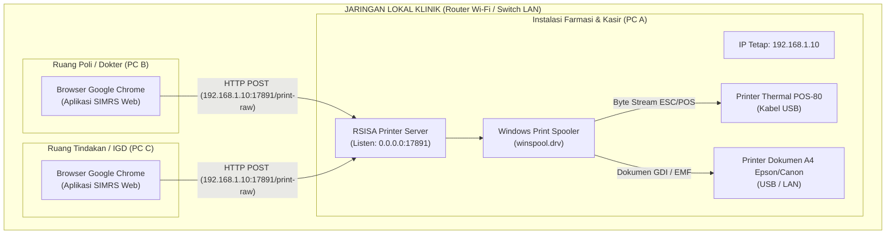

# Panduan Visual & Komik Strip: Mekanisme Kerja RSISA Printer Server

---

## 🗺️ Flow Diagram: Topologi Jaringan Wi-Fi/LAN Klinik

Diagram interaksi bagaimana seluruh PC di klinik saling berkomunikasi tanpa perlu membeli hardware Print Server eksternal:



---

## ⚙️ Langkah-Langkah Setting Praktis (3 Langkah Selesai)

### Langkah 1: Pengaturan di PC Induk Printer (PC Farmasi)
1. **Jalankan `RSISA-Printer-Server-windows-amd64.exe`** di PC Farmasi.
2. Buka tab **Pengaturan**:
   - Ganti **Alamat Dengarkan** menjadi: `0.0.0.0:17891` lalu klik **Simpan**.  
     *(Artinya: RSISA Printer Server siap menerima perintah cetak dari seluruh PC di jaringan klinik).*
3. Buka tab **Alamat Diizinkan**:
   - Masukkan alamat domain aplikasi web SIMRS Anda (contoh: `https://simrs.klinik.com` atau `http://192.168.1.5:8080`), lalu tekan **Tambah & Simpan**.  
     *(Hal ini wajib agar browser dokter tidak memblokir CORS).*
4. Pastikan status di pojok kanan atas berwarna hijau: **● Layanan berjalan**.

---

### Langkah 2: Hubungkan Printer (Bebas Port / Plug & Play)
1. Colokkan kabel USB printer thermal (`POS-80`, `TM-T82`, dll) ke slot USB PC Farmasi mana saja.
2. Buka tab **Printer** di RSISA Printer Server.
3. Klik tombol **`🖨️ Tes Cetak (Struk Thermal)`** untuk memastikan kertas keluar.
4. Selesai! **Tidak perlu menyetel COM3 atau USB001**. Windows Spooler langsung mengarahkannya secara otomatis.

---

### Langkah 3: Integrasi Tombol Cetak di Aplikasi Web Dokter
Di frontend web SIMRS, saat tombol cetak resep ditekan oleh dokter, arahkan request ke IP PC Farmasi:

```javascript
fetch("http://192.168.1.10:17891/print-raw", {
  method: "POST",
  headers: { "Content-Type": "application/json" },
  body: JSON.stringify({
    data: "\x1b\x40\x1ba\x01KLINIK SEHAT\nResep Pasien: Budi\n\n\n\n\x1d\x56\x41\x00"
  })
});
```

---

## ⚠️ Kondisi Kritis Lapangan yang Wajib Diperhatikan

> [!IMPORTANT]
> **1. Alamat IP Komputer Farmasi Harus Statis (Static IP)**  
> Jika PC Farmasi disetel DHCP biasa (IP dinamis), IP-nya bisa berubah-ubah dari `192.168.1.10` menjadi `192.168.1.45` saat router di-restart.  
> **Solusi:** Setel IP Static di Windows Network Settings PC Farmasi, atau lakukan *DHCP IP Reservation* di router mikrotik/modem klinik.

> [!WARNING]
> **2. Windows Defender Firewall (Inbound Rule Port 17891)**  
> Saat RSISA Printer Server pertama kali dijalankan dan disetel `0.0.0.0`, Windows akan memunculkan pop-up *Windows Security Alert*. Pastikan centang opsi **Private networks** dan klik **Allow access**.
> Jika PC dokter gagal terhubung (*Connection Timed Out*), buka Windows Firewall di PC Farmasi dan izinkan port TCP `17891`.

> [!TIP]
> **3. Kertas Habis / Kabel USB Tersenggol (Antrean Macet)**  
> Jika printer berbunyi bip kehabisan kertas saat jam ramai, Windows akan menandai antrean sebagai *Error - Printing*. Setelah kertas diisi ulang, cukup buka RSISA Printer Server dan klik tombol **`Bersihkan Antrean`** agar transaksi baru tidak tertahan.

> [!NOTE]
> **4. Isolasi Jaringan Wi-Fi (AP Isolation)**  
> Beberapa router Wi-Fi publik memiliki fitur keamanan bernama *AP Isolation* / *Client Isolation* (perangkat yang terhubung ke Wi-Fi tidak boleh saling berkomunikasi).  
> Pastikan fitur *AP Isolation* di router klinik **dinonaktifkan** agar laptop dokter di Wi-Fi bisa mengakses PC Farmasi yang terhubung ke kabel LAN.
