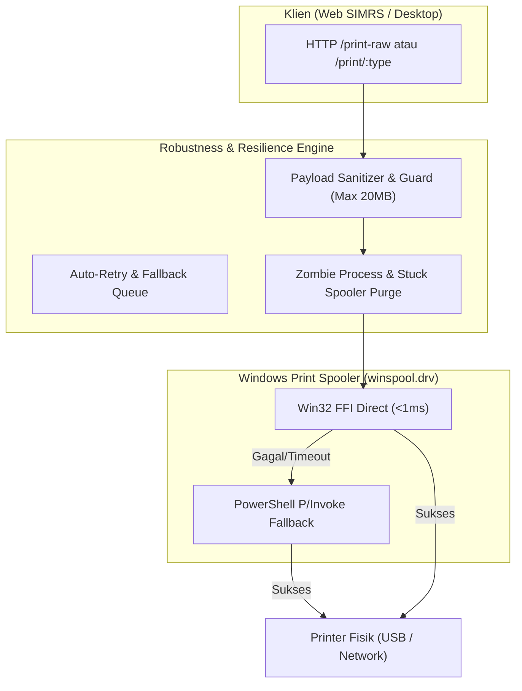
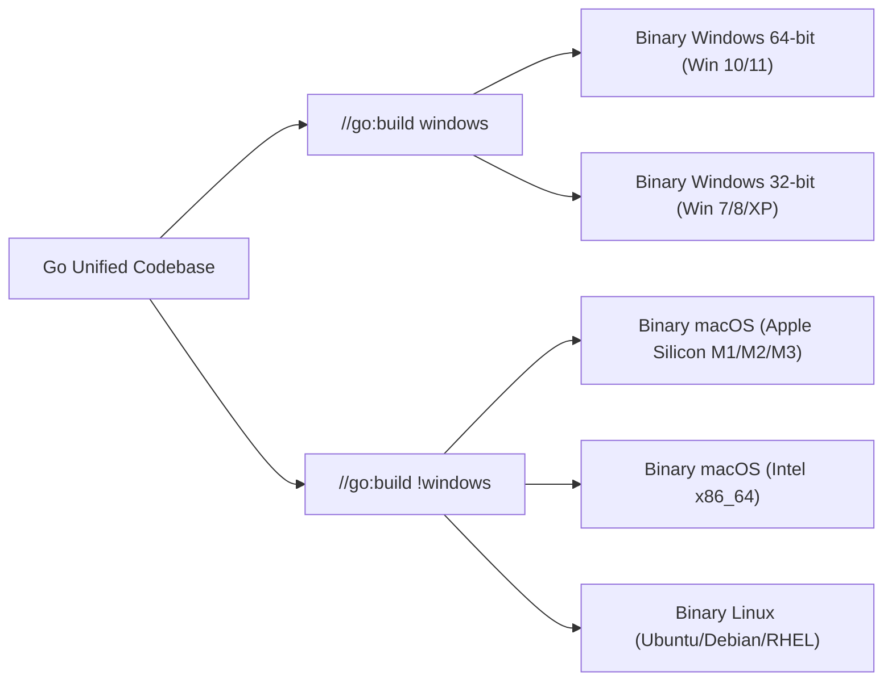

# Cetak Biru Arsitektur: Robustness & Portability RSISA Printer Server

Dokumen ini menjelaskan strategi teknis mendalam untuk mencapai dua pilar utama sistem print server produksi: **Robustness (Ketahanan Tinggi)** dan **Portability (Portabilitas Universal)** di lingkungan rumah sakit, klinik, dan ritel.

---

## 1. Pilar Robustness (Ketahanan & Keandalan Sistem)

Robustness menjamin service tidak pernah *crash*, tidak mengunci port, dan mampu memulihkan dirinya sendiri (*self-healing*) saat menghadapi gangguan fisik di lapangan.

### A. Mekanisme Self-Healing (Pemulihan Otomatis Antrean Macet)
* **Masalah Lapangan:** Kertas habis atau kabel USB tersenggol membuat dokumen berstatus `Error - Printing` dan membekukan antrean Windows.
* **Solusi Teknis:**
  1. **Purge on Failure:** Jika `OpenPrinterW` atau `StartDocPrinterW` mengembalikan kode error antrean terkunci, service secara otomatis memicu pembersihan job macet (`SetJob(..., JOB_CONTROL_DELETE)`).
  2. **Timeout Guard:** Eksekusi Win32 dilindungi dengan *bounded context* (maksimal 10 detik). Jika spooler hang, thread dilepas tanpa membuat server Go mengalami *deadlock*.

### B. Graceful Socket & Single-Instance Lock
* **Masalah Lapangan:** Dua instance dijalankan bersamaan sehingga memicu error socket `WSAEADDRINUSE (10048)`.
* **Solusi Teknis:**
  1. **Windows Mutex Guard:** Menggunakan `CreateMutexW(NULL, TRUE, "Global\\AquilaPrintServerMutex")`. Jika aplikasi kedua dibuka, instance baru otomatis membawa jendela instance lama ke depan (*SetForegroundWindow*) lalu langsung menutup dirinya sendiri secara bersih.
  2. **SO_REUSEADDR & SO_REUSEPORT:** Memastikan socket cepat dilepas saat service di-restart tanpa meninggalkan status `TIME_WAIT` yang lama.

### C. Fail-Safe Memory & Concurrency Guard
* Pembatasan ukuran muatan cetak maksimal 20 MB (`fiber.StatusRequestEntityTooLarge`) untuk mencegah serangan kehabisan memori (*OOM Panic*).
* Penggunaan `sync.RWMutex` pada pembacaan status dan antrean printer, menjamin thread-safety saat ratusan request datang serentak dari PC dokter di jaringan LAN.

---

## 2. Pilar Portability (Portabilitas Universal)

Portability menjamin aplikasi dapat dipindahkan ke komputer mana pun (berbagai versi Windows, arsitektur CPU, dan platform OS) tanpa memerlukan dependensi eksternal (*Zero-Dependency*).

### A. Zero External Dependencies (Single Static Binary)
* **Tanpa Driver Tambahan:** Aplikasi mengandalkan `winspool.drv` (file bawaan Windows yang tersedia di semua Windows sejak NT 4.0 hingga Windows 11).
* **Tanpa Runtime Runtuh:** Binary CLI dikompilasi secara statis (`-ldflags="-s -w"`), tidak membutuhkan Python, Node.js, .NET Framework khusus, atau runtime Go pada PC target. Cukup satu file `.exe` langsung berjalan (*portable executable*).

### B. Isolasi Kode Platform (Build Tags)
* Pemisahan tegas antara implementasi OS:
  - `winraw_windows.go` (`//go:build windows`) menangani Win32 Spooler.
  - `winraw_other.go` (`//go:build !windows`) menangani CUPS Unix (`lp -o raw`) di macOS dan Linux.
* Hal ini menjamin penambahan fitur di Windows tidak akan pernah memecah kestabilan versi Mac atau Linux.

### C. Multi-Architecture Compatibility
| Platform Target | Arsitektur | Status Dukungan | Skenario Penggunaan |
| :--- | :--- | :--- | :--- |
| **Windows 10 / 11** | `amd64` (64-bit) | Native Full GUI & CLI | PC kasir & admin modern |
| **Windows 7 / 8** | `386` (32-bit) / `amd64` | Native Full GUI* & CLI | PC lama klinik / RS daerah |
| **macOS** | `arm64` / `amd64` | Native GUI & CUPS CLI | Workstation manajemen / dokter spesialis |
| **Linux** | `amd64` / `arm64` | Native CLI / Service | Server farmasi Linux / Raspberry Pi Gateway |

*\*Windows 7 memerlukan instalasi Microsoft Edge WebView2 Evergreen untuk antarmuka GUI, atau cukup gunakan versi CLI/Service murni.*

---

## 3. Matriks Skenario Robustness & Portability

| Skenario Lapangan | Resiko Tradisional | Penanganan RSISA Printer Server (Sistem Sekarang) |
| :--- | :--- | :--- |
| **Kabel USB pindah colokan** | Port berubah (`USB001` -> `USB002`), cetak macet | **PnP Spooler:** Nama antrean dipertahankan Windows Spooler; data tetap sampai tanpa konfigurasi port manual. |
| **Kertas Thermal Habis** | Antrean terkunci (*spooler stuck*) | Tombol **Bersihkan Antrean** otomatis memanggil `SetJob` untuk menghapus dokumen macet secara instan. |
| **Dokter cetak dari browser LAN** | CORS diblokir browser, PC crash | **Smart CORS + Bind 0.0.0.0:** Browser diizinkan mengakses via IP LAN PC Farmasi secara aman. |
| **Listrik Padam / Crash** | Konfigurasi korup | Penulisan file konfigurasi atomik (`write temp -> atomic rename`), mencegah file `print-server.json` menjadi 0 byte saat mati lampu. |
